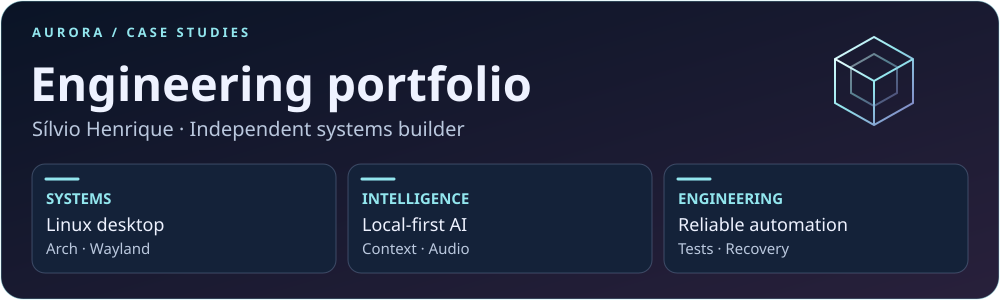
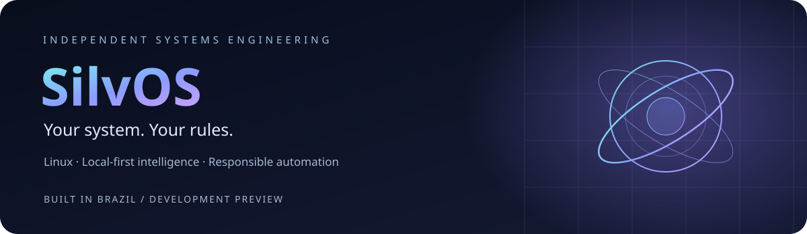
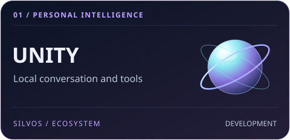
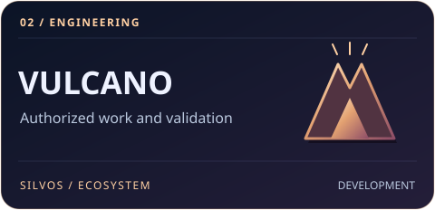
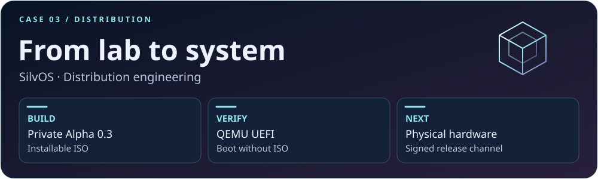
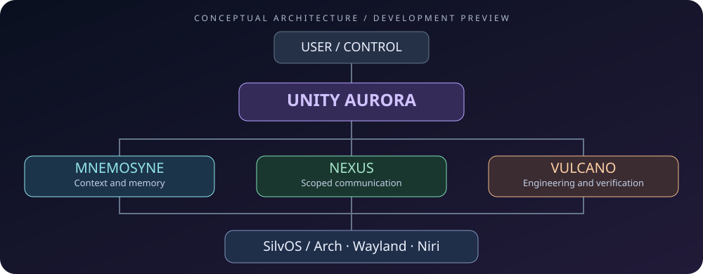
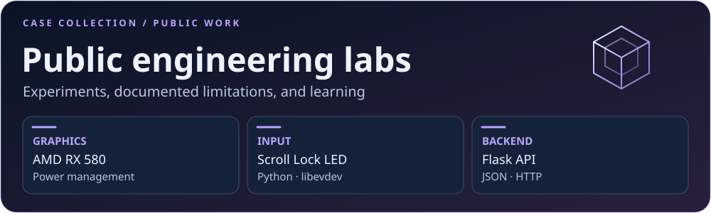
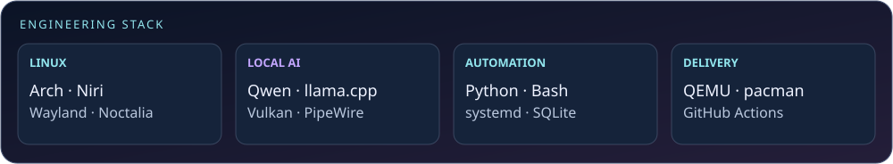

<a href="./PORTFOLIO.md">Português</a> · <strong>English</strong>

# Engineering portfolio

I am the creator of **SilvOS**, an independent Brazilian developer working across Linux integration, desktop experience, local artificial intelligence, automation and change validation.

This portfolio presents problems, engineering decisions, evidence and limitations for each project. I distinguish prototypes, laboratory rehearsals and validated capabilities.

<a href="#flagship">Case studies</a> · <a href="#public-projects">Public projects</a> · <a href="#engineering-method">Method</a> · <a href="#contact">Contact</a>

---

## SilvOS | Flagship project

**Role:** creator and technical direction of the independent project. **Stage:** active development, pre-release.

The project combines an Arch Linux and Wayland-based distribution, a distinct visual experience, local intelligence and engineering tools. The main codebase remains private; this public presentation does not constitute a release.

[Official website ↗](https://silviodarko.github.io/en.html) · [Roadmap](./SILVOS_ROADMAP.md) · [Brand studio ↗](https://silviodarko.github.io/brand.html)

### 01 · UNITY Aurora | Personal intelligence

**Challenge:** How can a local assistant integrate with a desktop without treating conversation as unrestricted authorization?

**Approach:** Glass interface, Alive orb, streaming, recoverable context, audio and scoped tools. Separate memory, communication and execution responsibilities.

**Evidence and limitations:** Lab integration builds and regressions documented. Final desktop validation, cancellation and resource behavior remain acceptance gates.

Qwen · llama.cpp · PipeWire · Wayland · Python

### 02 · VULCANO | Verifiable engineering

**Challenge:** How can consecutive jobs run without losing results, duplicating work or mistaking a test for authorization?

**Approach:** Scoped contracts, revision checks, isolated tests, receipts, reconciliation and recovery. Deterministic automation first.

**Evidence and limitations:** Sequential execution and recovery rehearsals used simulated dependencies. Physical installation and consecutive real production remain pending.

Python · SQLite · systemd · Git · regression tests

### 03 · SilvOS Linux | Distribution engineering

**Challenge:** How can a customized desktop become an installable, verifiable and recoverable distribution?

**Approach:** Arch packaging, private ISO builds, UEFI installation rehearsals, post-boot checks and secondary-disk integrity verification.

**Evidence and limitations:** Alpha 0.3 installed on a virtual qcow2 disk, with ISO-free boot and desktop, network and CLI validation. Not physical hardware certification. No public update channel yet.

PKGBUILD · pacman · QEMU · GitHub Actions

### 04 · Mnemosyne, NEXUS and Mobile | Systems integration

**Challenge:** How can persistent context, communication and devices connect without implicitly expanding authority?

**Approach:** Selective memory, scoped operational transport, receipts and an experimental paired Android client. Each component has a distinct responsibility.

**Evidence and limitations:** Integrations in development and validation; experimental mobile alpha. Physical device validation and expanded capabilities are future steps.

APIs · SQLite · Android · service integration

---

## Public projects | Labs and development

### Radeon RX 580 | Linux stability investigation

**Problem:** investigate freezes and amdgpu power-management behavior.  
**Artifacts:** shell script, sample systemd service, documented limitations and recovery.  
**Maturity:** experimental. No universal GPU detection or automated hardware test suite; not a ready-to-install fix.

[View code and documentation ↗](https://github.com/silviodarko/rx580-linux-stability-fix)

### Scroll Lock LED | Linux input events

**Problem:** keyboard indicator not following the expected state in certain Wayland sessions.  
**Approach:** Python and libevdev to observe events and control supported LEDs, with a sample systemd service.  
**Maturity:** experimental workaround; dependent on device, permissions and environment. Not a compositor patch.

[View code and documentation ↗](https://github.com/silviodarko/scrolllock-wlroots-fix)

### Flask API | JSON over HTTP

**Problem:** expose simulated spreadsheet data through an HTTP interface.  
**Approach:** Python, Flask and a JSON endpoint.  
**Maturity:** educational project, not presented as a production API.

[View repository ↗](https://github.com/silviodarko/API.Flask.COLAB)

### Practical learning | Other documented exercises

| Project | What its README describes |
| --- | --- |
| [Image Processing Package](https://github.com/silviodarko/image-processing-package) | Image operations, histograms, similarity and resizing. |
| [DIO Twitter Python](https://github.com/silviodarko/dio-twitter-py) | Integration exercise using FastAPI, MongoDB, Docker and pytest. |
| [Python / SQLite / MongoDB](https://github.com/silviodarko/Python.SQLite.MongoDB) | Relational modeling with SQLAlchemy and NoSQL documents with PyMongo. |

Descriptions are based on public READMEs. These are learning projects, not audited tools; they were not executed or certified in this review.

---

## Engineering method

| Stage | Practice |
| --- | --- |
| Discovery | Define the problem, constraints, environment and acceptance criteria. |
| Implementation | Versioned changes, limited scope and reusable components. |
| Validation | Regression, isolation and distinction between simulation and physical environments. |
| Delivery | Artifact verification, review and recovery mechanisms. |
| Evolution | Document limits, fix regressions and measure resources. |

**Principles:** privacy by default, explicit authorization, traceability, recovery and verified compatibility before support claims.

## Contact and collaboration

Interests: Linux desktops, local AI, systems integration, automation and user experience.

[LinkedIn](https://www.linkedin.com/in/s%C3%ADlvio-henrique-faria-b23a1b165/) · [GitHub profile](./README.en.md) · [Project catalog](./PROJECTS.md) · [SilvOS website](https://silviodarko.github.io/en.html)

---

<strong>Engineering independence, one commit at a time.</strong> Built in Brazil · Independent engineering

