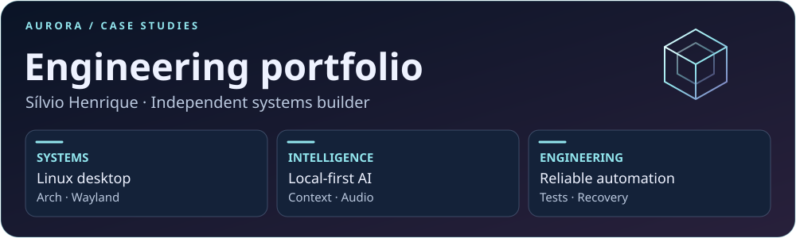
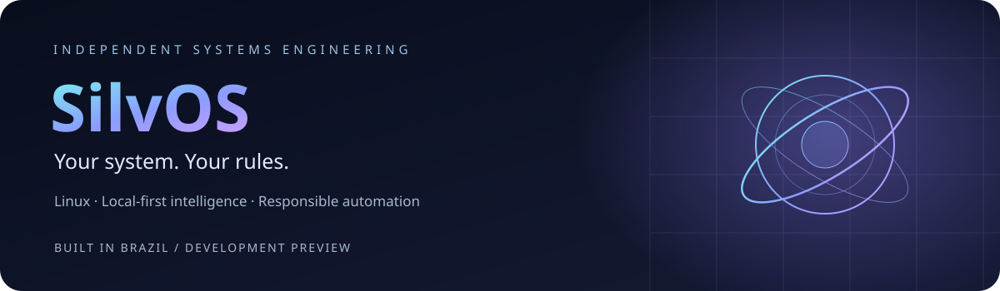
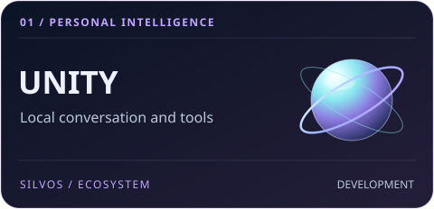
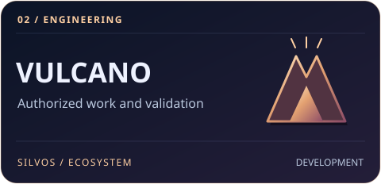
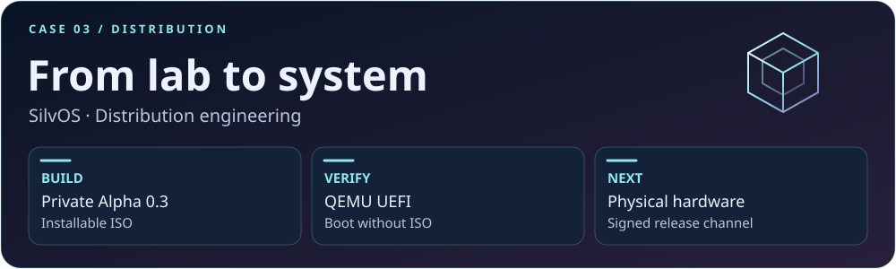
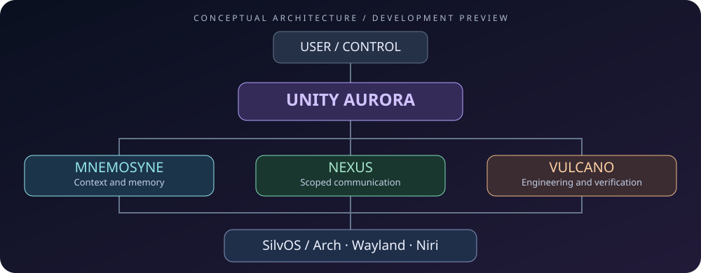
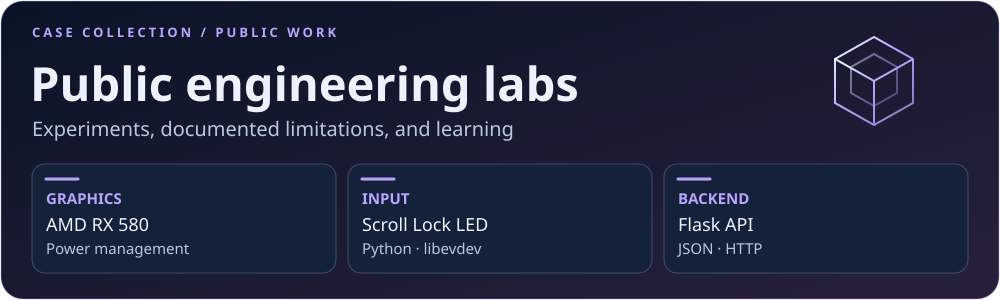
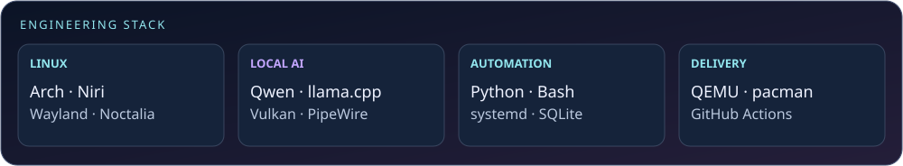

<strong>Português</strong> · <a href="./PORTFOLIO.en.md">English</a>

# Portfólio de engenharia

Sou criador do **SilvOS** e desenvolvedor independente brasileiro. Meu trabalho técnico reúne integração de sistemas Linux, experiência desktop, inteligência artificial local, automação e validação de mudanças.

Este portfólio apresenta problemas, decisões de engenharia, evidências e limites de cada projeto. Diferencio protótipos, ensaios em laboratório e funcionalidades homologadas.

<a href="#projeto-principal">Estudos de caso</a> · <a href="#projetos-publicos">Projetos públicos</a> · <a href="#metodo-de-trabalho">Método</a> · <a href="#contato">Contato</a>

---

## SilvOS | Projeto principal

**Papel:** criação e direção técnica do projeto independente. **Fase:** desenvolvimento ativo, pré-lançamento.

A proposta combina uma distribuição baseada em Arch Linux e Wayland com uma experiência visual própria, inteligência local e ferramentas de engenharia. O código principal permanece privado; a apresentação pública não equivale à disponibilização de uma release.

[Site oficial ↗](https://silviodarko.github.io/) · [Roadmap](./SILVOS_ROADMAP.md) · [Identidade visual ↗](https://silviodarko.github.io/brand.html)

### 01 · UNITY Aurora | Inteligência pessoal

**Desafio:** Como integrar um assistente local ao desktop sem transformar conversação em autorização irrestrita?

**Abordagem:** Integração de interface Glass, esfera Alive, streaming, contexto recuperável, áudio e ferramentas com escopo definido. Separação entre memória, comunicação e execução.

**Evidência e limites:** Montagem e regressões de integração registradas em laboratório. A validação final no desktop, cancelamento e comportamento de recursos continuam como critérios de aceite.

Qwen · llama.cpp · PipeWire · Wayland · Python

### 02 · VULCANO | Engenharia verificável

**Desafio:** Como executar trabalhos consecutivos sem perder resultados, duplicar tarefas ou confundir testes com autorização?

**Abordagem:** Contratos delimitados, verificação de revisões, testes isolados, recibos, reconciliação e mecanismos de recuperação. Prioridade à automação determinística.

**Evidência e limites:** Ensaios sequenciais e de recuperação realizados com dependências simuladas. Instalação física e produção consecutiva real permanecem pendentes.

Python · SQLite · systemd · Git · testes de regressão

### 03 · SilvOS Linux | Engenharia de distribuição

**Desafio:** Como transformar um desktop personalizado em uma distribuição instalável, verificável e recuperável?

**Abordagem:** Empacotamento Arch, construção de ISO privada, ensaio de instalação UEFI, testes pós-boot e verificação da integridade de um segundo disco.

**Evidência e limites:** Alpha 0.3 instalada em disco virtual qcow2, com boot sem ISO e validação de desktop, rede e CLI. Não equivale a certificação de hardware físico. Canal público de atualização ainda não liberado.

PKGBUILD · pacman · QEMU · GitHub Actions

### 04 · Mnemosyne, NEXUS e Mobile | Integração de sistemas

**Desafio:** Como conectar contexto persistente, comunicação e dispositivos sem ampliar implicitamente a autoridade?

**Abordagem:** Memória seletiva, transporte operacional com escopo restrito, recibos e cliente Android experimental com pareamento. Cada componente tem responsabilidade própria.

**Evidência e limites:** Integrações em desenvolvimento e validação; cliente móvel em alpha experimental. A validação física do aparelho e ampliação de capacidades são etapas futuras.

APIs · SQLite · Android · integração de serviços

---

## Projetos públicos | Laboratórios e desenvolvimento

### Radeon RX 580 | Diagnóstico de estabilidade no Linux

**Problema:** investigar travamentos e comportamento de energia do driver amdgpu.  
**Artefatos:** script shell, exemplo de serviço systemd e documentação de limites e recuperação.  
**Maturidade:** experimental. Não há detecção universal da GPU ou testes automatizados de hardware; não é correção pronta para instalação.

[Ver código e documentação ↗](https://github.com/silviodarko/rx580-linux-stability-fix)

### Scroll Lock LED | Eventos de entrada Linux

**Problema:** indicador de teclado que não acompanha o estado esperado em determinadas sessões Wayland.  
**Abordagem:** Python e libevdev para observar eventos e controlar LEDs suportados, com exemplo de serviço systemd.  
**Maturidade:** workaround experimental; dependente do dispositivo, permissões e ambiente. Não é patch do compositor.

[Ver código e documentação ↗](https://github.com/silviodarko/scrolllock-wlroots-fix)

### Flask API | Dados JSON via HTTP

**Problema:** disponibilizar dados simulados de planilha por uma interface HTTP.  
**Abordagem:** Python, Flask e endpoint JSON.  
**Maturidade:** projeto educacional; não apresentado como API de produção.

[Ver repositório ↗](https://github.com/silviodarko/API.Flask.COLAB)

### Formação prática | Outros exercícios documentados

| Projeto | O que o README descreve |
| --- | --- |
| [Image Processing Package](https://github.com/silviodarko/image-processing-package) | Operações de imagem, histogramas, similaridade e redimensionamento. |
| [DIO Twitter Python](https://github.com/silviodarko/dio-twitter-py) | Exercício de integração com FastAPI, MongoDB, Docker e pytest. |
| [Python / SQLite / MongoDB](https://github.com/silviodarko/Python.SQLite.MongoDB) | Exercício de modelagem relacional com SQLAlchemy e documentos NoSQL com PyMongo. |

Essas descrições vêm dos READMEs públicos. São trabalhos de aprendizagem, não ferramentas auditadas; não foram executados ou certificados nesta revisão.

---

## Método de trabalho

| Etapa | Prática |
| --- | --- |
| Descoberta | Definir problema, restrições, ambiente e critérios de sucesso. |
| Implementação | Mudanças versionadas, escopo limitado e componentes reaproveitáveis. |
| Validação | Regressão, isolamento e distinção entre simulação e ambiente físico. |
| Entrega | Conferência dos artefatos, revisão e mecanismo de recuperação. |
| Evolução | Documentar limites, corrigir regressões e medir recursos. |

**Princípios:** privacidade por padrão, autorização explícita, rastreabilidade, recuperação e compatibilidade comprovada antes de anunciar suporte.

## Contato e colaboração

Interesses: Linux desktop, IA local, integração de sistemas, automação e experiências de usuário.

[LinkedIn](https://www.linkedin.com/in/s%C3%ADlvio-henrique-faria-b23a1b165/) · [Perfil GitHub](./README.md) · [Catálogo de projetos](./PROJECTS.md) · [Site SilvOS](https://silviodarko.github.io/)

---

<strong>Engineering independence, one commit at a time.</strong> Built in Brazil · Independent engineering

