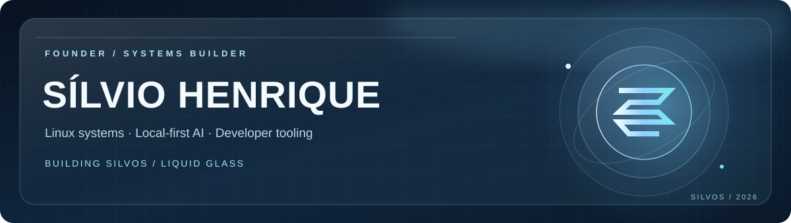

<a href="./README.md">Português</a> · <strong>English</strong>

  

  <strong>Building tools that put people in control of their own technology.</strong> 
  Independent builder • Linux engineering • Local-first AI • Automation

  
  
  

---

### Vision

I'm **Sílvio Henrique**, an independent developer and creator of **SilvOS**. My work connects Linux systems, automation, user experience, and locally executed artificial intelligence.

I aim to turn technical experiments into tools that are **well designed, reproducible, private by default, and maintainable**.

> **Build with purpose. Automate responsibly. Keep people in control.**

### Flagship project · SilvOS

**SilvOS** is an independent Linux distribution **in development**, built on an Arch Linux foundation with a customized desktop experience, productivity tools, and a local AI layer.

| Focus area | Technology and direction |
| :--- | :--- |
| **Desktop** | Arch Linux · Wayland · Niri / Lniri · Noctalia · Kitty |
| **User experience** | Liquid Glass · transparency & blur · GTK / CSS · Qt / QML interfaces |
| **Jarvis, local AI** | Qwen3 · llama.cpp · Whisper · Piper · Kokoro ONNX experiments |
| **Integration & automation** | Python · Bash · JavaScript · systemd user services · GitHub API |
| **Secure bridge** | authorized actions · input validation · SHA-256 · backups & rollback |
| **Distribution engineering** | PKGBUILD · pacman · GitHub Actions · isolated testing · lab-only GPG signing |

**What we're building**

- **A distinct Linux desktop experience**, integrating Wayland composition, visual customization, and productivity applications.
- **An actually useful local assistant** designed for conversation, speech recognition, explicitly authorized tasks, and privacy.
- **A desktop bridge** with tightly scoped operations, execution receipts, and recovery mechanisms.
- **An installable and maintainable distro**, evolving from versioned packages and repeatable tests to a future installation ISO.

**Project status:** actively developed, *pre-release*. The desktop is used on my personal machine, but **SilvOS does not yet have a public ISO or a stable release**. The development repository is private at this stage. Some integrations and GPU acceleration are still under evaluation.

**Public roadmap:** [SilvOS development milestones](./SILVOS_ROADMAP.md) · high-level plans, no private implementation details.

### Technology stack

**Systems & languages**

**Desktop, tooling & delivery**

**AI & inference:** Qwen3 · llama.cpp · Whisper ASR · Piper TTS · Kokoro ONNX (experimental) · Vulkan / RADV (performance evaluation).

This stack includes technologies used, integrated, or studied across projects; maturity varies by component.

### Selected public work

| Project | Focus |
| :--- | :--- |
| [RX580 Linux Stability Fix](https://github.com/silviodarko/rx580-linux-stability-fix) | Experimental Linux AMD GPU power-management lab and documentation. |
| [Scroll Lock wlroots Fix](https://github.com/silviodarko/scrolllock-wlroots-fix) | Experimental Python/libevdev keyboard LED workaround with systemd sample. |
| [Flask API](https://github.com/silviodarko/API.Flask.COLAB) | Python/Flask HTTP API experiment with JSON data. |

**[Explore my curated engineering portfolio](./PORTFOLIO.en.md)** · Selected projects, technical context and maturity.

### GitHub achievements

  

Official achievements are awarded by GitHub for eligible activity. [See my achievements](https://github.com/silviodarko?tab=achievements).

---

  <strong>Engineering independence, one commit at a time.</strong> 
  SilvOS • Built in Brazil 🇧🇷 • Work in progress, intentionally.

