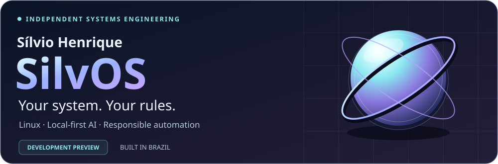
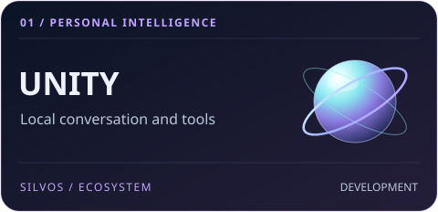
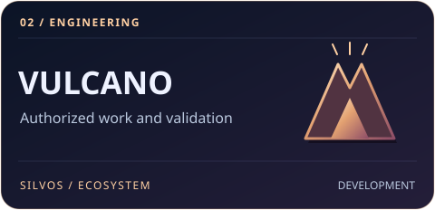
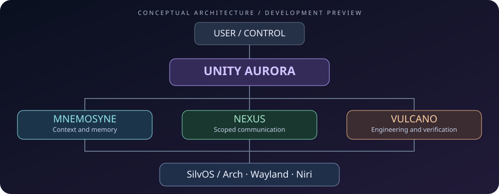
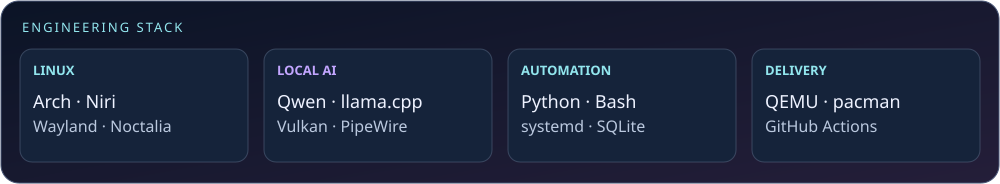

<a href="./README.md">Português</a> · <strong>English</strong>

<strong>Independent Linux. Local intelligence. Purposeful engineering.</strong>

<a href="https://silviodarko.github.io/en.html"><strong>Official website ↗</strong></a> &nbsp;·&nbsp;
<a href="./SILVOS_ROADMAP.md">Roadmap</a> &nbsp;·&nbsp;
<a href="./PORTFOLIO.en.md">Portfolio</a> &nbsp;·&nbsp;
<a href="https://www.linkedin.com/in/s%C3%ADlvio-henrique-faria-b23a1b165/">LinkedIn</a>

---

## 01 · The project

I am a Brazilian independent developer and creator of **SilvOS**, a Linux distribution in development on Arch Linux and Wayland. I build tools connecting desktop experience, local intelligence and verifiable automation while keeping users in control.

The personal workstation is used daily. The distribution's new integrations remain pre-release.

## 02 · The next generation

<table width="100%">
<tr>
<td width="50%" valign="top">

<strong>UNITY Aurora</strong> 
Local conversation, streaming, memory, voice and authorized tools in an Aurora Glass interface. Integration and final desktop validation in progress.
</td>
<td width="50%" valign="top">

<strong>VULCANO</strong> 
Engineering execution, tests, verifiable receipts and recovery. Lab candidate; continuous physical production pending.
</td>
</tr>
</table>

| Component | Responsibility |
| --- | --- |
| **Aurora Glass** | Visual experience, Alive orb, HUD and preferences. |
| **Mnemosyne** | Persistent memory and context retrieval. |
| **NEXUS** | Scoped operational communication. |
| **UNITY Mobile** | Experimental Android client, pairing and restricted access. |
| **SilvOS Linux** | Arch, Niri, Noctalia, packages, installation and recovery. |

[Explore the ecosystem ↗](https://silviodarko.github.io/en.html#ecosystem) · [Brand studio ↗](https://silviodarko.github.io/brand.html)

## 03 · Engineering in practice

I work on desktop integration, local inference, audio, deterministic automation, regression testing, packaging and recovery. The stack includes current use, research and integration, not a certified distribution feature list.

## 04 · From the lab to daily use

| Milestone | Documented status |
| --- | --- |
| **Alpha 0.3** | QEMU UEFI validation: installation, ISO-free boot, desktop, network, CLI and secondary disk preservation. |
| **Aurora** | Lab integration build and regressions; final installation pending. |
| **Vulcano** | Sequential execution and recovery rehearsals with simulated dependencies; continuous physical production pending. |
| **Distribution** | Signing, verification and recovery prototypes; no public update channel. |
| **Hardware** | Proposed validation matrix and adaptive profiles, not certified. |

**No public ISO, release date or universal hardware support announced.** The architecture describes project direction, not unrestricted autonomy.

[Roadmap and release gates →](./SILVOS_ROADMAP.md)

## 05 · Selected public projects

| Project | Area |
| --- | --- |
| [RX580 Linux Stability Fix](https://github.com/silviodarko/rx580-linux-stability-fix) | AMD GPU diagnostics and power management · experimental |
| [Scroll Lock wlroots Fix](https://github.com/silviodarko/scrolllock-wlroots-fix) | Linux keyboard events, Python and systemd · experimental |
| [Flask API](https://github.com/silviodarko/API.Flask.COLAB) | HTTP API and JSON · educational |

[Full portfolio](./PORTFOLIO.en.md) · [Project catalog](./PROJECTS.md) · [All repositories](https://github.com/silviodarko?tab=repositories)

---

<strong>Engineering independence, one commit at a time.</strong> Built in Brazil · Independent Linux project

<a href="https://github.com/developer">GitHub Developer Program</a> · <a href="https://github.com/silviodarko?tab=achievements">Official achievements: Pull Shark and Quickdraw</a>

Individual participation, without institutional partnership or endorsement. The main codebase remains private at this stage. Public material describes objectives, sanitized evidence and limitations.
