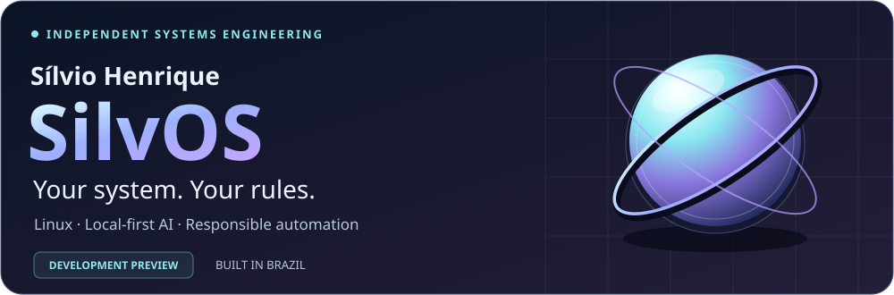
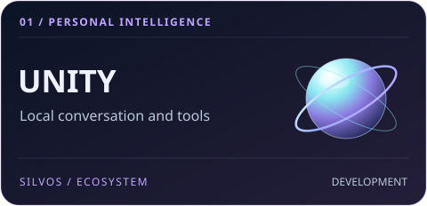
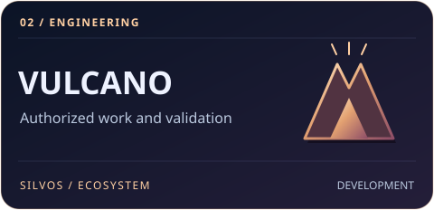
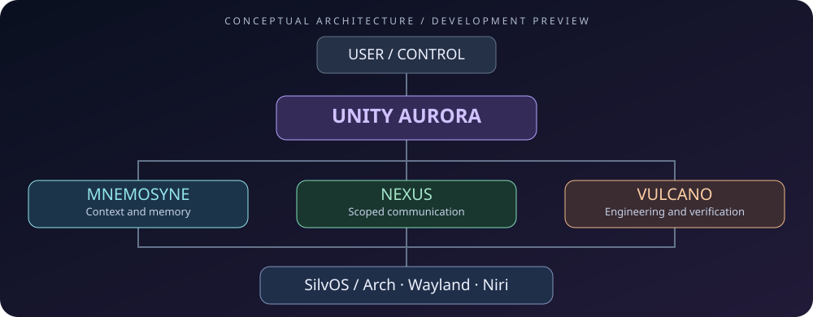
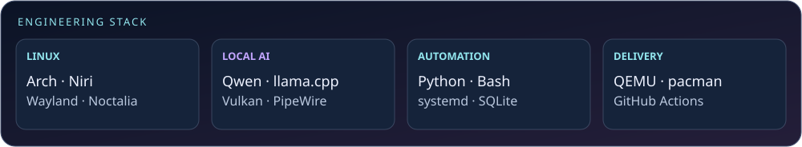

<strong>Português</strong> · <a href="./README.en.md">English</a>

<strong>Linux independente. Inteligência local. Engenharia com propósito.</strong>

<a href="https://silviodarko.github.io/"><strong>Site oficial ↗</strong></a> &nbsp;·&nbsp;
<a href="./SILVOS_ROADMAP.md">Roadmap</a> &nbsp;·&nbsp;
<a href="./PORTFOLIO.md">Portfólio</a> &nbsp;·&nbsp;
<a href="https://www.linkedin.com/in/s%C3%ADlvio-henrique-faria-b23a1b165/">LinkedIn</a>

---

## 01 · O projeto

Sou desenvolvedor independente brasileiro e criador do **SilvOS**, uma distribuição Linux em desenvolvimento sobre Arch Linux e Wayland. Construo ferramentas que aproximam experiência desktop, inteligência local e automação verificável, mantendo o usuário no controle.

O ambiente pessoal é utilizado no cotidiano. As novas integrações da distribuição continuam em pré-lançamento.

## 02 · A próxima geração

<table width="100%">
<tr>
<td width="50%" valign="top">

<strong>UNITY Aurora</strong> 
Conversação local, streaming, memória, voz e ferramentas autorizadas em uma interface Aurora Glass. Integração e homologação Desktop em andamento.
</td>
<td width="50%" valign="top">

<strong>VULCANO</strong> 
Execução de engenharia, testes, recibos verificáveis e recuperação. Candidata em laboratório; produção contínua física pendente.
</td>
</tr>
</table>

| Componente | Responsabilidade |
| --- | --- |
| **Aurora Glass** | Experiência visual, esfera Alive, HUD e preferências. |
| **Mnemosyne** | Memória persistente e recuperação de contexto. |
| **NEXUS** | Comunicação operacional com escopo delimitado. |
| **UNITY Mobile** | Cliente Android experimental, pareamento e acesso restrito. |
| **SilvOS Linux** | Arch, Niri, Noctalia, pacotes, instalação e recuperação. |

[Explore o ecossistema ↗](https://silviodarko.github.io/#ecossistema) · [Identidade visual ↗](https://silviodarko.github.io/brand.html)

## 03 · Engenharia em prática

Trabalho com integração desktop, inferência local, áudio, automação determinística, testes de regressão, empacotamento e mecanismos de recuperação. A stack combina tecnologias em uso, estudo e integração, não uma lista de recursos certificados.

## 04 · Do laboratório ao cotidiano

| Marco | Estado documentado |
| --- | --- |
| **Alpha 0.3** | Validada em QEMU UEFI: instalação, boot sem ISO, desktop, rede, CLI e preservação do segundo disco. |
| **Aurora** | Montagem e regressões de integração em laboratório; instalação final pendente. |
| **Vulcano** | Ensaios sequenciais e recuperação com dependências simuladas; produção física contínua pendente. |
| **Distribuição** | Protótipos de assinatura, verificação e recuperação; canal público não liberado. |
| **Hardware** | Matriz de testes e perfis adaptativos propostos, ainda não certificados. |

**Sem ISO pública, data de lançamento ou suporte universal anunciado.** A arquitetura descreve a direção do projeto, não autonomia irrestrita.

[Roadmap e critérios de lançamento →](./SILVOS_ROADMAP.md)

## 05 · Projetos públicos selecionados

| Projeto | Área |
| --- | --- |
| [RX580 Linux Stability Fix](https://github.com/silviodarko/rx580-linux-stability-fix) | Diagnóstico e energia de GPU AMD · experimental |
| [Scroll Lock wlroots Fix](https://github.com/silviodarko/scrolllock-wlroots-fix) | Eventos de teclado Linux, Python e systemd · experimental |
| [Flask API](https://github.com/silviodarko/API.Flask.COLAB) | API HTTP e JSON · educacional |

[Portfólio completo](./PORTFOLIO.md) · [Catálogo de projetos](./PROJECTS.md) · [Todos os repositórios](https://github.com/silviodarko?tab=repositories)

---

<strong>Engineering independence, one commit at a time.</strong> Built in Brazil · Independent Linux project

<a href="https://github.com/developer">GitHub Developer Program</a> · <a href="https://github.com/silviodarko?tab=achievements">Conquistas oficiais: Pull Shark e Quickdraw</a>

Participação individual, sem parceria ou endosso institucional. O código principal permanece privado nesta fase. Apenas objetivos, evidências sanitizadas e limites são publicados.
