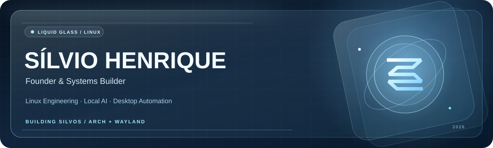
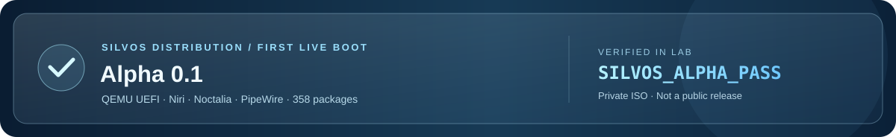

<strong>Português</strong> · <a href="./README.en.md">English</a>

  

  <strong>Construindo um Linux com transparência, privacidade e inteligência local.</strong> 
  Independent builder • Linux engineering • Local-first AI • Automation

  
  
  

---

### Visão / Vision

Sou **Sílvio Henrique**, desenvolvedor independente e criador do **SilvOS**. Trabalho na interseção entre sistemas Linux, automação, interfaces e inteligência artificial executada localmente.

Meu objetivo é transformar experimentação técnica em produtos **bem desenhados, reproduzíveis, privados por padrão e simples de manter**.

> **Build with purpose. Automate responsibly. Keep people in control.**

### Projeto principal · SilvOS

**SilvOS** é uma distribuição Linux independente **em desenvolvimento**, construída sobre uma base Arch Linux com uma experiência visual própria, ferramentas de produtividade e uma camada de IA local.

| Área | Tecnologias e direção |
| :--- | :--- |
| **Desktop** | Arch Linux · Wayland · Niri / Lniri · Noctalia · Kitty |
| **Design & experience** | Liquid Glass · transparência e blur · GTK / CSS · interfaces Qt / QML |
| **Jarvis, IA local** | Qwen3 · llama.cpp · Whisper · Piper · experimentos com Kokoro ONNX |
| **Integração e automação** | Python · Bash · JavaScript · systemd user · GitHub API |
| **Ponte segura** | ações autorizadas · validação de comandos · SHA-256 · backups e rollback |
| **Engenharia de distribuição** | PKGBUILD · pacman · GitHub Actions · testes isolados · assinatura GPG em laboratório |

**O que estamos construindo**

- **Uma experiência desktop própria**, com composição Wayland, personalizações visuais e aplicações integradas.
- **Um assistente local de verdade**, para conversar, interpretar voz, executar ações previamente autorizadas e respeitar a privacidade.
- **Uma ponte entre dispositivos e o desktop**, com operações restritas, recibos de execução e mecanismos de recuperação.
- **Uma distribuição instalável e atualizável**, com uma Alpha 0.3 instalável já validada em QEMU UEFI e um sistema de pacotes e atualizações próprio em desenvolvimento.

**Status do projeto:** desenvolvimento ativo / *pre-release*. A experiência já é utilizada no meu ambiente pessoal, mas **o SilvOS ainda não possui ISO pública ou lançamento estável**. O repositório de desenvolvimento permanece privado nesta fase. Algumas integrações e aceleração por GPU estão em pesquisa e validação.

  

**Marco Alpha 0.3 (novembro de 2026):** a **ISO instalável privada** concluiu a instalação num disco virtual qcow2, iniciou pelo próprio disco em QEMU UEFI **sem a ISO** e passou por testes de Niri/Wayland, Noctalia, rede, `silvos-cli` e SHA-256 do disco sentinela. O teste privado foi concluído com sucesso; isso **não é homologação para hardware físico, release estável nem download público**. [Veja os próximos passos](./SILVOS_ROADMAP.md).

**Site oficial do SilvOS:** [silviodarko.github.io](https://silviodarko.github.io/) · Liquid Glass, Jarvis e roadmap público.

**Roadmap público:** [SilvOS development milestones](./SILVOS_ROADMAP.md) · versão resumida, sem detalhes privados.

### Da Alpha 0.3 ao `silvos update`

| Etapa | Situação |
| :--- | :--- |
| ISO instalável e boot UEFI sem a mídia | **Validado em QEMU** (laboratório privado) |
| Niri, Noctalia, rede e `silvos-cli` no sistema instalado | **Validados em QEMU** |
| Primeiro pacote `silvos-cli` e assinatura GPG temporária | **Testados em CI isolado** |
| Compilação do `silvos-lniri` personalizado | **Em validação**, linkagem `libspa` pendente |
| Repositório `silvos-testing` e chave de release | **Ainda não disponíveis** |
| Upgrade N → N+1 e rollback em VM | **Próxima prioridade** |
| `silvos update` com atualização real no desktop | **Bloqueado até homologação** |

O protótipo `silvos update --check` consulta a base local do Pacman, sem baixar ou instalar nada. O objetivo final é ter atualizações completas via `pacman -Syu` e pacotes próprios assinados, preservando as personalizações Glass. Não se trata de um atualizador de produção disponível hoje.

**Página oficial:** [SilvOS • progresso e atualizações](https://silviodarko.github.io/#atualizacoes).

### Developer Program &amp; GitHub API

Minha inscrição no **[GitHub Developer Program](https://github.com/developer)** foi confirmada em novembro de 2026, voltado à criação de integrações com a API do GitHub. A Ponte SilvOS é nosso laboratório de ações autenticadas, controles de segurança, recibos de execução e recuperação. Essa participação **não representa parceria, certificação ou endosso oficial do GitHub**.

### Technology stack

**Systems & languages**

**Desktop, tooling & delivery**

**AI & inference:** Qwen3 · llama.cpp · Whisper ASR · Piper TTS · Kokoro ONNX (experimental) · Vulkan / RADV (avaliação de desempenho).

Stack composta por tecnologias em uso, integração ou estudo nos projetos. O nível de maturidade varia por componente.

### Projetos públicos em destaque

| Projeto | Foco |
| :--- | :--- |
| [RX580 Linux Stability Fix](https://github.com/silviodarko/rx580-linux-stability-fix) | Laboratório experimental de gerenciamento de energia e diagnóstico de GPUs AMD no Linux. |
| [Scroll Lock wlroots Fix](https://github.com/silviodarko/scrolllock-wlroots-fix) | Workaround experimental de LED de teclado com Python, libevdev e systemd. |
| [Flask API](https://github.com/silviodarko/API.Flask.COLAB) | Experimento de API HTTP com Python, Flask e dados JSON. |

**[Explorar meu portfólio técnico completo](./PORTFOLIO.md)** · Projetos selecionados, contexto e maturidade de cada um.

### Atividade no GitHub

Selos e conquistas oficiais são exibidos pelo próprio GitHub quando os critérios são atendidos. [Ver conquistas e selos do perfil](https://github.com/silviodarko?tab=achievements). A participação no Developer Program não é apresentada aqui como um selo oficial já concedido.

---

  <strong>Engineering independence, one commit at a time.</strong> 
  SilvOS • Built in Brazil 🇧🇷 • Work in progress, intentionally.

